# mugen-assets

Personagens e stages MUGEN empacotados em `.zip` para o [ultimate-mugen](https://github.com/juninmd/ultimate-mugen).

## Layout

- `chars/<Nome>.zip` contém `<Nome>/<Nome>.def` e os arquivos do personagem.
- `stages/<Nome>.zip` usa caminhos relativos à raiz do MUGEN: `stages/*.def`, `stages/*.sff` e `sound/*` (música, quando existe).

- `umf/<Nome>/` é um lutador `umf/2` do ultimate-mugen: `<id>.json` mais `sprites/*.png` (poses, `meta.json` e `01_idle.png`). `umf/<Nome>.zip` é gerado por `python tools/pack_umf.py <Nome>` e o CI confere que o zip bate com a pasta.

## Adicionar conteúdo

Todo zip em `chars/`, `stages/` ou `umf/` precisa de uma print em `previews/<chars|stages|umf>/<mesmo nome>.png`. O CI (`tools/check_previews.py`) bloqueia o PR se faltar print, se o zip estiver corrompido, se não seguir o layout acima ou se tiver caminhos absolutos/`..`.

```bash
pip install pillow numpy
python tools/preview.py chars/NovoChar.zip stages/NovoStage.zip
```

O gerador lê o `.sff` (v1 e v2): personagem mostra retrato (9000,1) e pose parada (0,0); stage monta as camadas do `[BGdef]`.

## Origem

Extraído de packs públicos no archive.org:

| Pack | Conteúdo usado |
|---|---|
| [Dragon Ball x Naruto Storm Budokai Mugen](https://archive.org/details/dragon-ball-x-naruto-storm-budokai-mugen) | 30 chars, 8 stages |
| [DC Comics Mugenation Project](https://archive.org/details/dc-comics-mugenation-project-for-android-pc-unotag.-7z) | 20 chars, 5 stages |
| [Marvel Mugenation Project 2021](https://archive.org/details/marvel-mugenation-project-2021-for-android-pc.-7z) | 20 chars, 5 stages |
| [Ferchogt X's Mugen Characters](https://archive.org/details/ferchogt-x-mugen-characters) | 2 chars (MvC2 Iori, SonSon) |
| [Pokemon Type Stage (MUGEN)](https://archive.org/details/pokemon-type-stage_202508) | 6 stages com música (Fire, Water, Ghost, Dragon, Ice, Electric) |

Personagens e stages pertencem aos seus autores originais (veja o readme dentro de cada zip). Franquias são marcas de seus donos; uso pessoal, não comercial.

## Personagens (73)

<table>
<tr><td align="center">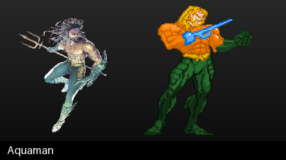<br><sub>Aquaman</sub></td><td align="center">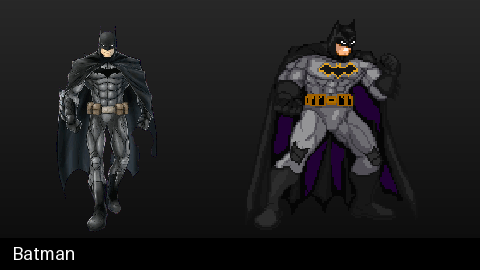<br><sub>Batman_Rebirth</sub></td><td align="center">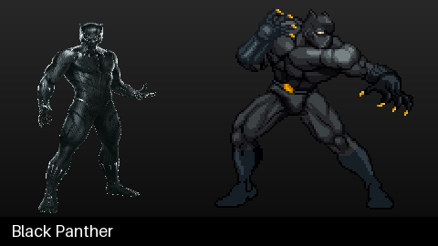<br><sub>BlackPanther</sub></td><td align="center"><br><sub>BlackWidow</sub></td></tr>
<tr><td align="center">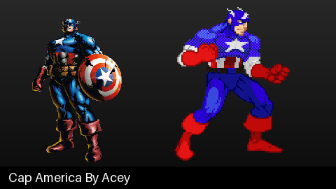<br><sub>CaptainAmerica</sub></td><td align="center">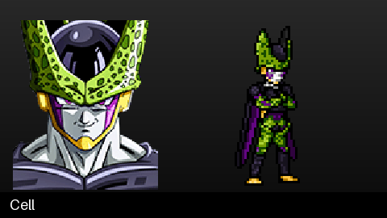<br><sub>Cell_Perfect_Form</sub></td><td align="center">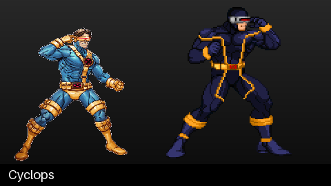<br><sub>Cyclops</sub></td><td align="center">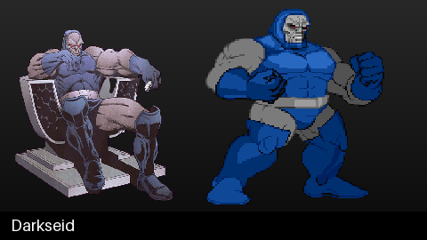<br><sub>Darkseid</sub></td></tr>
<tr><td align="center">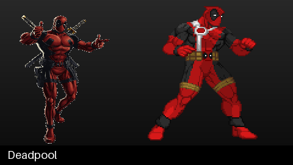<br><sub>Deadpool</sub></td><td align="center">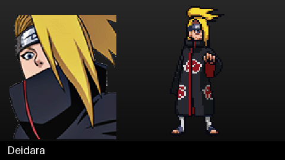<br><sub>Deidara</sub></td><td align="center">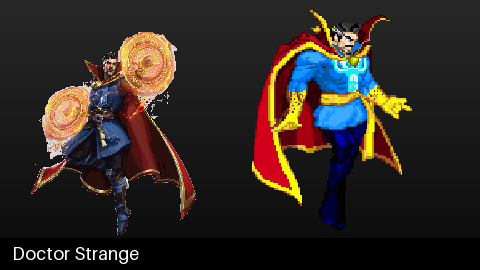<br><sub>DoctorStrange</sub></td><td align="center">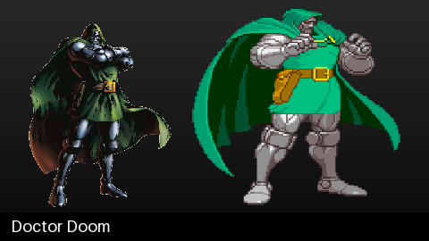<br><sub>Doctor_Doom</sub></td></tr>
<tr><td align="center">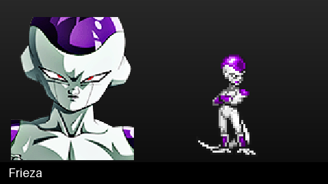<br><sub>Freezer_4_Form</sub></td><td align="center">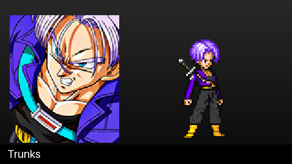<br><sub>Future_Trunks</sub></td><td align="center">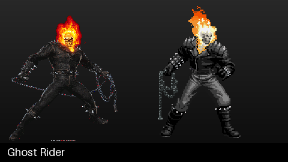<br><sub>Ghost_Rider</sub></td><td align="center">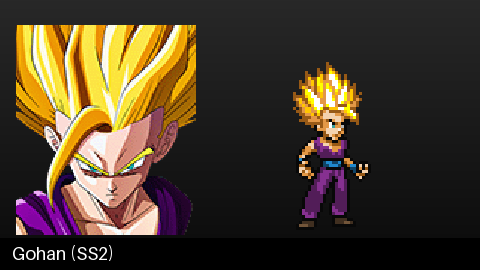<br><sub>Gohan_Teen_SS2</sub></td></tr>
<tr><td align="center">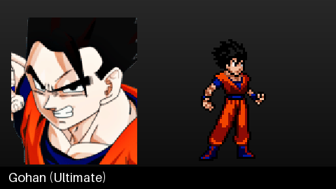<br><sub>Gohan_Ultimate</sub></td><td align="center">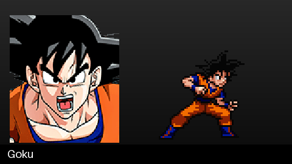<br><sub>Goku_Base</sub></td><td align="center">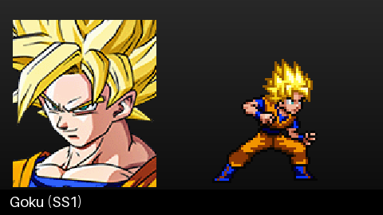<br><sub>Goku_SS</sub></td><td align="center">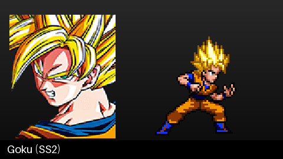<br><sub>Goku_SS2</sub></td></tr>
<tr><td align="center">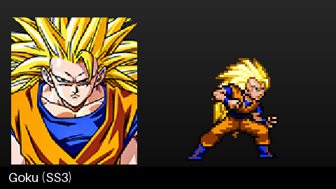<br><sub>Goku_SS3</sub></td><td align="center">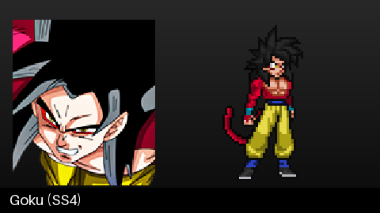<br><sub>Goku_SS4</sub></td><td align="center">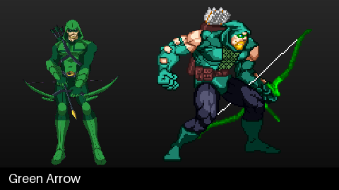<br><sub>GreenArrow_G</sub></td><td align="center">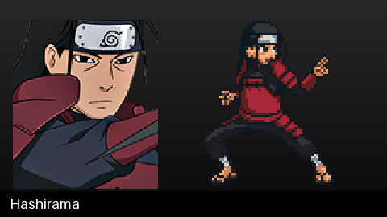<br><sub>Hashirama</sub></td></tr>
<tr><td align="center">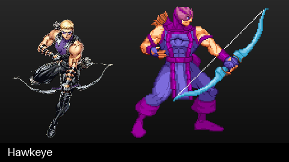<br><sub>Hawkeye</sub></td><td align="center">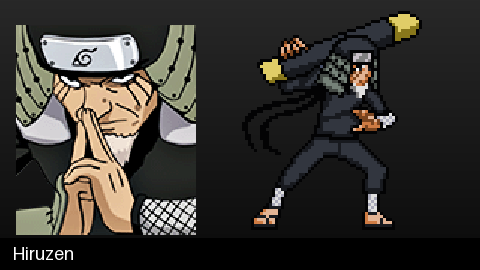<br><sub>Hiruzen</sub></td><td align="center">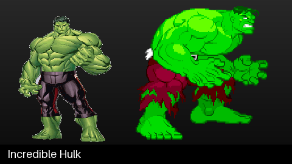<br><sub>IncredibleHulk</sub></td><td align="center">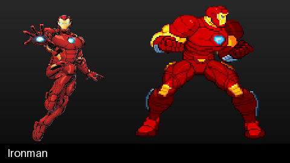<br><sub>Ironman</sub></td></tr>
<tr><td align="center">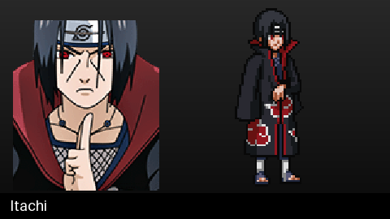<br><sub>Itachi</sub></td><td align="center">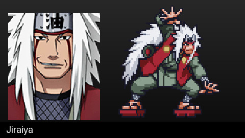<br><sub>Jiraiya</sub></td><td align="center">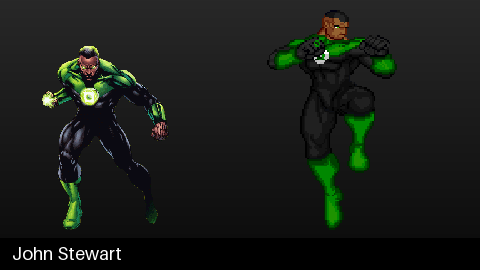<br><sub>JohnStewartwil</sub></td><td align="center">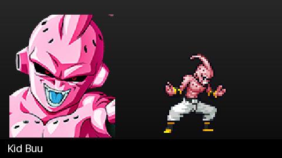<br><sub>Kid_Buu</sub></td></tr>
<tr><td align="center">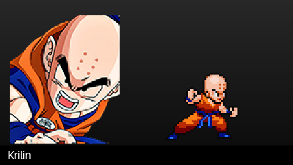<br><sub>Krilin</sub></td><td align="center">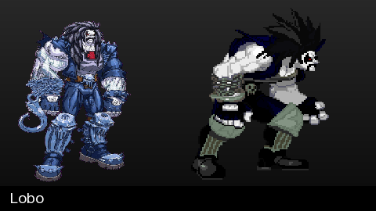<br><sub>Lobo</sub></td><td align="center">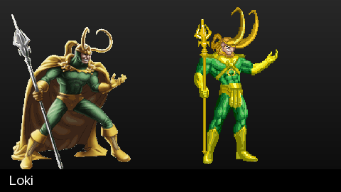<br><sub>Loki</sub></td><td align="center">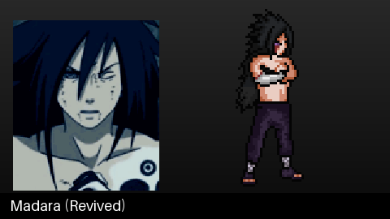<br><sub>Madara_Revived</sub></td></tr>
<tr><td align="center">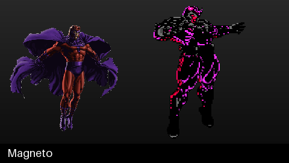<br><sub>Magneto</sub></td><td align="center">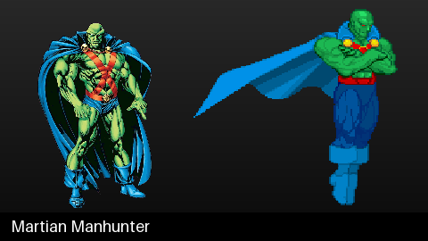<br><sub>MartianManhunter</sub></td><td align="center">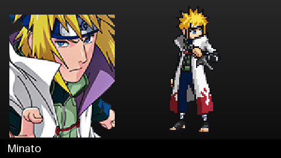<br><sub>Minato</sub></td><td align="center">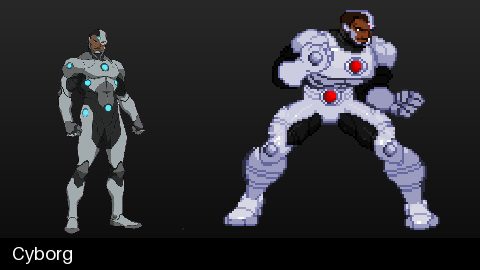<br><sub>MvC2_Cyborg</sub></td></tr>
<tr><td align="center">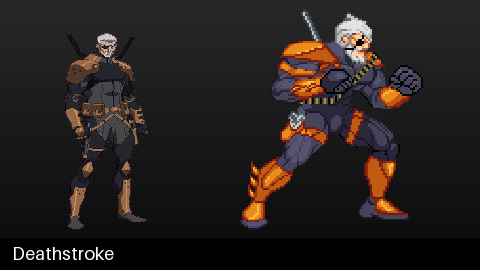<br><sub>MvC_DeathstrokeEO</sub></td><td align="center">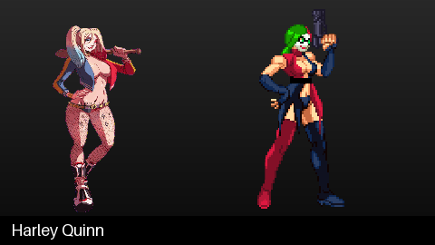<br><sub>MvC_Harley_Quinn</sub></td><td align="center">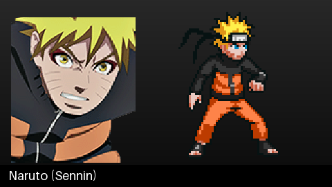<br><sub>Naruto_Sennin</sub></td><td align="center">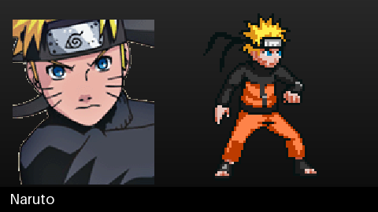<br><sub>Naruto_Start</sub></td></tr>
<tr><td align="center">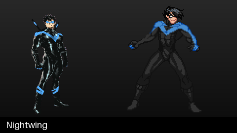<br><sub>Nightwing_MvC</sub></td><td align="center">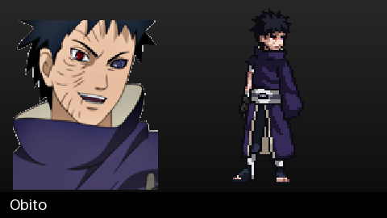<br><sub>Obito</sub></td><td align="center">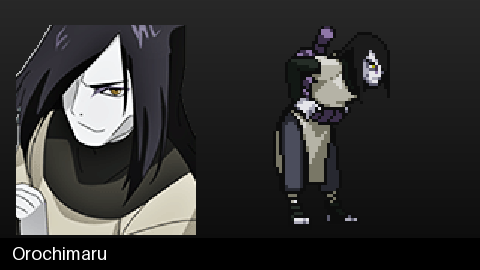<br><sub>Orochimaru</sub></td><td align="center">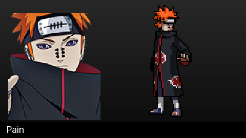<br><sub>Pain</sub></td></tr>
<tr><td align="center">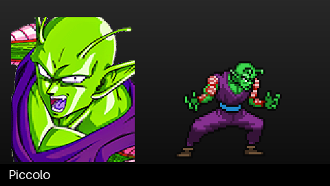<br><sub>Piccolo</sub></td><td align="center">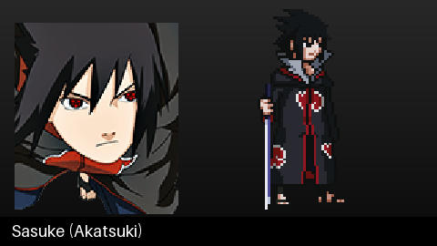<br><sub>Sasuke_Akatsuki</sub></td><td align="center">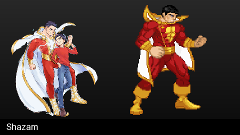<br><sub>Shazam_G</sub></td><td align="center"><br><sub>Silver_surfer</sub></td></tr>
<tr><td align="center"><br><sub>Spiderman</sub></td><td align="center"><br><sub>Storm</sub></td><td align="center"><br><sub>Supergirl</sub></td><td align="center"><br><sub>Thanos</sub></td></tr>
<tr><td align="center"><br><sub>TheFlashnew52</sub></td><td align="center"><br><sub>The_Joker</sub></td><td align="center"><br><sub>Thor_Odinson</sub></td><td align="center"><br><sub>Tobirama</sub></td></tr>
<tr><td align="center"><br><sub>Trunks_Future_SS</sub></td><td align="center"><br><sub>Tsunade</sub></td><td align="center"><br><sub>Vegeta_Majin</sub></td><td align="center"><br><sub>Venom</sub></td></tr>
<tr><td align="center"><br><sub>Wolverine</sub></td><td align="center"><br><sub>Wonder_Woman_New52</sub></td><td align="center"><br><sub>bane</sub></td><td align="center"><br><sub>blackadam</sub></td></tr>
<tr><td align="center"><br><sub>doomsday</sub></td><td align="center"><br><sub>superman</sub></td></tr>
<tr><td align="center"><br><sub>Goku_SSJ4_Vision</sub></td></tr>
<tr><td align="center"><br><sub>MvC2_Iori</sub></td><td align="center"><br><sub>MvC2_Sonson</sub></td></tr>
</table>

## Stages (24)

<table>
<tr><td align="center"><br><sub>Academia_Ninja</sub></td><td align="center"><br><sub>AvengersDay_1.1Zoom</sub></td><td align="center"><br><sub>Campo3</sub></td></tr>
<tr><td align="center"><br><sub>DarkCerebro-X3TOG(GBA)_1.1Zoom</sub></td><td align="center"><br><sub>Examendechunnin</sub></td><td align="center"><br><sub>Gotham-City</sub></td></tr>
<tr><td align="center"><br><sub>Grand_Fisher_Stage</sub></td><td align="center"><br><sub>Hall_of_Justice</sub></td><td align="center"><br><sub>HydraAircraftBase_1.1Zoom</sub></td></tr>
<tr><td align="center"><br><sub>KryptonDestroyed</sub></td><td align="center"><br><sub>LTDsLexcorpDemolished</sub></td><td align="center"><br><sub>OscorpLab_1.1Zoom</sub></td></tr>
<tr><td align="center"><br><sub>WayneManorRuins_1.1Zoom</sub></td><td align="center"><br><sub>dbcity</sub></td><td align="center"><br><sub>dbnamek</sub></td></tr>
<tr><td align="center"><br><sub>dbz_kame_house</sub></td><td align="center"><br><sub>tenkaichiHR</sub></td><td align="center"><br><sub>xmagneto</sub></td></tr>
<tr><td align="center"><br><sub>Pokemon_FireType</sub></td><td align="center"><br><sub>Pokemon_WaterType</sub></td><td align="center"><br><sub>Pokemon_GhostType</sub></td><td align="center"><br><sub>Pokemon_DragonType</sub></td></tr>
<tr><td align="center"><br><sub>Pokemon_IceType</sub></td><td align="center"><br><sub>Pokemon_ElectricType</sub></td></tr>
</table>

## Lutadores UMF (3)

<table>
<tr><td align="center"><br><sub>BlackWidow_UMF</sub></td><td align="center"><br><sub>Goku_SSJ4_UMF</sub></td><td align="center"><br><sub>Goku_SSJ4_Vision_UMF (_Vision)</sub></td></tr>
</table>
